<div align="center">



<br/>

<a href="https://github.com/banlyfgt"></a>

<a href="mailto:banly.master@gmail.com"></a>

</div>

---

## 👋 About me

```js
const banly = {
  handle: "banlyfgt",
  role: "Software developer",          // ✏️ edit me
  currentlyBuilding: "something fun",  // ✏️ edit me
  currentlyLearning: ["TypeScript", "System design", "AI tooling"],
  askMeAbout: ["web dev", "automation", "shipping side projects"],
  funFact: "I debug best after coffee ☕",
};
```

- 🔭 Currently working on **your next big idea here**
- 🌱 Learning **new things every week**
- 💬 Ask me about **whatever you're stuck on**
- ⚡ Fun fact: **replace me with something memorable**

## 🛠️ Tech stack

<div align="center">


</div>

## 📊 GitHub stats

<div align="center">

<picture>
  <source media="(prefers-color-scheme: dark)" srcset="https://github-readme-stats.vercel.app/api?username=banlyfgt&show_icons=true&theme=tokyonight&hide_border=true&bg_color=0f172a&count_private=true" />
  
</picture>
<picture>
  <source media="(prefers-color-scheme: dark)" srcset="https://github-readme-stats.vercel.app/api/top-langs/?username=banlyfgt&layout=compact&theme=tokyonight&hide_border=true&bg_color=0f172a" />
  
</picture>

<br/>

<picture>
  <source media="(prefers-color-scheme: dark)" srcset="https://streak-stats.demolab.com?user=banlyfgt&theme=tokyonight&hide_border=true&background=0f172a" />
  
</picture>

</div>

## 📌 Featured projects

| Project | What it is | Stack |
| :-- | :-- | :-- |
| **[project-one](https://github.com/banlyfgt)** | One-line pitch of your best project | `TypeScript` `React` |
| **[project-two](https://github.com/banlyfgt)** | One-line pitch of another project | `Python` |
| **[project-three](https://github.com/banlyfgt)** | One-line pitch of a third project | `Node.js` |

## 🤝 Let's connect

<div align="center">

[](mailto:banly.master@gmail.com)
[](https://linkedin.com/in/your-handle)
[](https://x.com/your-handle)

<br/>


</div>
